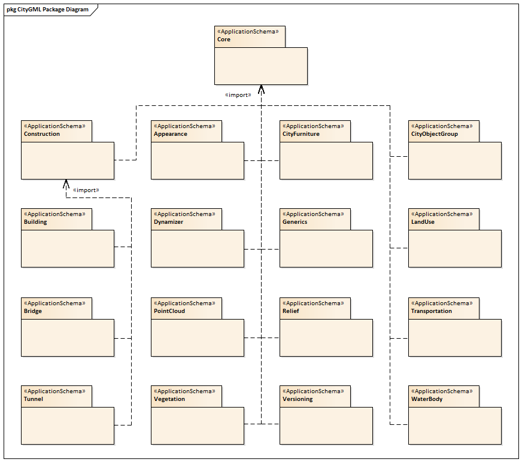

[[conceptual-model-section]]
== CityGML UML Model

The CityGML UML model is the normative definition of the CityGML Conceptual Model. The tables and figures in this section were software generated from the UML model. As such, this section provides a normative representation of the CityGML Conceptual Model.

An alternate representation can be found in the Data Dictionary in <<data-dictionary-section>>.

[[rc_overview-section]]
=== Structural Overview of Requirements Classes

The Requirements Classes for this standard are structured as
UML Packages as illustrated in <<package-diagram>>. Each Requirements Class is specified in detail in their respective subsections. These subsections include a UML diagram, data dictionary, and the applicable requirements.

[[package-diagram]]
.CityGML UML Packages

A detailed discussion of the structuring of the UML model can be found in the  link:http://docs.opengeospatial.org/DRAFTS/20-066.html#ug-model-structure-section[OGC CityGML 3.0 Users Guide].

[[core_section]]
include::clause_8_2_core.adoc[]

[[appearance_section]]
include::clause_8_3_appearance.adoc[]

[[city_furniture_section]]
include::clause_8_4_city_furniture.adoc[]

[[city_object_group_section]]
include::clause_8_5_city_object_group.adoc[]

[[dynamizer_section]]
include::clause_8_6_dynamizer.adoc[]

[[generics_section]]
include::clause_8_7_generics.adoc[]

[[land_use_section]]
include::clause_8_8_land_use.adoc[]

[[pointcloud_section]]
include::clause_8_9_pointcloud.adoc[]

[[relief_section]]
include::clause_8_10_relief.adoc[]

[[transportation_section]]
include::clause_8_11_transportation.adoc[]

[[vegetation_section]]
include::clause_8_12_vegetation.adoc[]

[[versioning_section]]
include::clause_8_13_versioning.adoc[]

[[waterbody_section]]
include::clause_8_14_waterbody.adoc[]

[[construction_section]]
include::clause_8_15_construction.adoc[]

[[bridge_section]]
include::clause_8_16_bridge_model.adoc[]

[[building_section]]
include::clause_8_17_building_model.adoc[]

[[tunnel_section]]
include::clause_8_18_tunnel.adoc[]
