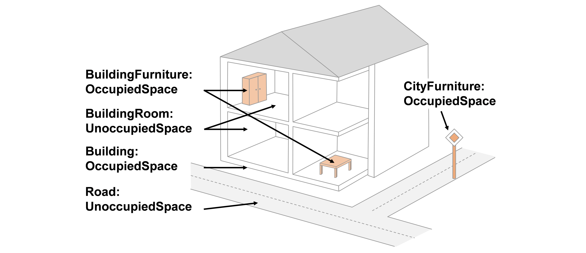
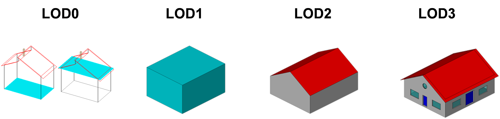
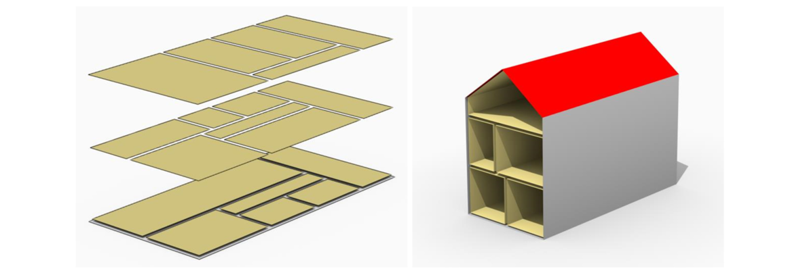
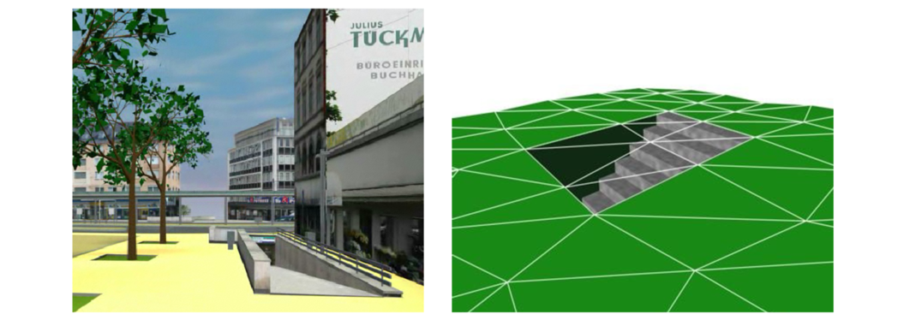
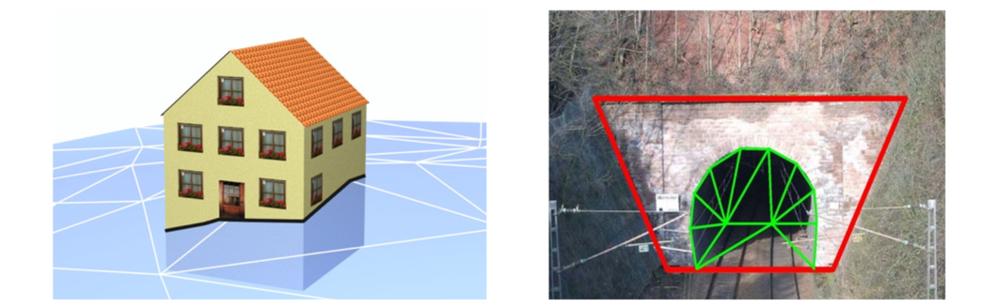

[[ug-coremodel-section]]
=== CityGML Core Model: Space Concept, Levels of Detail, Special Spatial Types
(http://docs.opengeospatial.org/DRAFTS/20-010.html#overview-section-coremodel[Imported from the CityGML 3.0 Standard])

==== Spaces and Space Boundaries

 In the CityGML 3.0 Conceptual Model, a clear semantic distinction of spatial features is introduced by mapping all city objects onto the semantic concepts of spaces and space boundaries. A _Space_ is an entity of volumetric extent in the real world. Buildings, water bodies, trees, rooms, and traffic spaces are examples for such entities with volumetric extent. A _Space Boundary_ is an entity with areal extent in the real world. Space Boundaries delimit and connect Spaces. Examples are the wall surfaces and roof surfaces that bound a building, the water surface as boundary between the water body and air, the road surface as boundary between the ground and the traffic space, or the digital terrain model representing the space boundary between the over- and underground space.

 To obtain a more precise definition of spaces, they are further subdivided into physical spaces and logical spaces. Physical spaces are spaces that are fully or partially bounded by physical objects. Buildings and rooms, for instance, are physical spaces as they are bounded by walls and slabs. Traffic spaces of roads are physical spaces as they are bounded by road surfaces against the ground. Logical spaces, in contrast, are spaces that are not necessarily bounded by physical objects, but are defined according to thematic considerations. Depending on the application, logical spaces can also be bounded by non-physical, i.e., virtual boundaries, and they can represent aggregations of physical spaces. A building unit, for instance, is a logical space as it aggregates specific rooms to flats, the rooms being the physical spaces that are bounded by wall surfaces, whereas the aggregation as a whole is being delimited by a virtual boundary. Other examples are city districts which are bounded by virtual vertically extruded administrative boundaries, public spaces vs. Security zones in airports, or city zones with specific regulations stemming from urban planning. The definition of physical and logical spaces and of corresponding physical and virtual boundaries is in line with the discussion in [<<Smith2000>>] on the difference between bona fide and fiat boundaries to bound objects. Bona fide boundaries are physical boundaries; they correspond to the physical boundaries of physical spaces in the CityGML 3.0 CM. In contrast, fiat boundaries are man-made boundaries. They are equivalent to the virtual boundaries of logical spaces.

 Physical spaces, in turn, are further classified into occupied spaces and unoccupied spaces. Occupied spaces represent physical volumetric objects that occupy space in the urban environment. Examples for occupied spaces are buildings, bridges, trees, city furniture, and water bodies. Occupying space means that some space is blocked by these volumetric objects. For instance, the space blocked by the building in <<figure-occupiedandunoccupiedspaces>> cannot be used any more for driving through this space or placing a tree on that space. In contrast, unoccupied spaces represent physical volumetric entities that do not occupy space in the urban environment, i.e., no space is blocked by these volumetric objects. Examples for unoccupied spaces are building rooms and traffic spaces. There is a risk of misunderstanding the term OccupiedSpace. However, we decided to use the term anyway, as it is established in the field of robotics for over three decades [<<Elfes1989>>]. The navigation of mobile robots makes use of a so-called occupancy map that marks areas that are occupied by matter and, thus, are not navigable for robots.

[[figure-occupiedandunoccupiedspaces]]
.Occupied and unoccupied spaces

 The new space concept offers several advantages.

* In the CityGML 3.0 Conceptual Model, all geometric representations are only defined in the _Core_ module. This makes (a) models of the thematic modules simpler as they no longer need to be associated directly with the geometry classes, and (b) implementation easier as all spatial concepts have only to be implemented once in the _Core_ module. All thematic modules like _Building_, _Relief_, _WaterBody_, etc. inherit their geometric representations from the _Core_ module.
* The space concept supports the expression of explicit topological, geometrical, and thematic relations between spaces and spaces, spaces and space boundaries, and space boundaries and space boundaries. Thus, implementing the checking of geometric-topological consistency will become easier. That is because most checks can be expressed and performed on the CityGML _Core_ module and then automatically applied to all thematic modules
* For the analysis of navigable spaces (e.g., to generate IndoorGML data from CityGML) algorithms can be defined on the level of the _Core_ module. These algorithms will then work with all CityGML feature classes and also ADEs as they are derived from the _Core_. The same is true for other applications of 3D city models listed in [<<Biljecki2015>>] such as visibility analyses including shadow casting or solar irradiation analyses.
* Practitioners and developers do not see much of the space concept. That is because the space and space boundary classes are just abstract classes. Only elements representing objects from concrete subclasses such as Building, BuildingRoom, or TrafficSpace will appear in CityGML data sets.

==== Modeling City Objects by the Composition of Spaces

 Semantic objects in CityGML are often composed of parts, i.e., they form multi-level aggregation hierarchies. This also holds for semantic objects representing occupied and unoccupied spaces. In general, two types of compositions can be distinguished.

. *Spatial partitioning*: Semantic objects of either the space type OccupiedSpace or UnoccupiedSpace are subdivided into different parts that are of the same space type as the parent object. Examples are Buildings that can be subdivided into BuildingParts, or Buildings that are partitioned into ConstructiveElements. Buildings as well as BuildingParts and constructiveElements represent OccupiedSpaces. Similarly, Roads can be subdivided into TrafficSpaces and AuxiliaryTrafficSpaces, all objects being UnoccupiedSpaces.
. *Nesting of alternating space types*: Semantic objects of one space type contain objects that are of the opposite space type as the parent object. Examples are Buildings (OccupiedSpace) that contain BuildingRooms (UnoccupiedSpace), BuildingRooms (UnoccupiedSpace) that contain Furniture (OccupiedSpace), and Roads (UnoccupiedSpace) that contain CityFurniture (OccupiedSpace). The categorization of a semantic object into occupied or unoccupied takes place at the level of the object in relation to the parent object. A building is part of a city model. Thus, in the first place the building occupies urban space within a city. As long as the interior of the building is not modeled in detail, the space covered by the building needs to be considered as occupied and only viewable from the outside. To make the building accessible inside, voids need to be added to the building in the form of building rooms. The rooms add free space to the building interior. In other words, the OccupiedSpace now contains some UnoccupiedSpace. The free space inside the building can, in turn, contain objects that occupy space again, such as furniture or installations. In contrast, roads also occupy urban space in the city. However, this space is initially unoccupied as it is accessible by cars, pedestrian, or cyclists. Adding traffic signs or other city furniture objects to the free space results in specific sections of the road becoming occupied by these objects. Thus, one can also say that occupied spaces are mostly filled with matter; whereas, unoccupied spaces are mostly free of matter and, thus, realize free spaces.

==== Rules for Surface Orientations of OccupiedSpaces and UnoccupiedSpaces

 The classification of feature types into OccupiedSpace and UnoccupiedSpace also defines the semantics of the geometries attached to the respective features. For OccupiedSpaces, the attached geometries describe volumes that are (mostly) physically occupied. For UnoccupiedSpaces, the attached geometries describe (or bound) volumes that are (mostly) physically unoccupied. This also has an impact on the required orientation of the surface normal (at point _P_ this is a vector perpendicular to the tangent plane of the surface at __P__) for attached thematic surfaces. For OccupiedSpaces, the normal vectors of thematic surfaces must point in the same direction as the surfaces of the outer shell of the volume. For UnoccupiedSpaces, the normal vectors of thematic surfaces must point in the opposite direction as the surfaces of the outer shell of the volume. This means that from the perspective of an observer of a city scene, the surface normals must always be directed towards the observer. In the case of OccupiedSpaces (e.g., Buildings, Furniture), the observer must be located outside the OccupiedSpace for the surface normals being directed towards the observer; whereas in the case of UnoccupiedSpaces (e.g., Rooms, Roads), the observer is typically inside the UnoccupiedSpace.

[[overview-section-levelsofdetail]]
==== Levels of Detail (LOD)

 The CityGML Conceptual Model differentiates four consecutive Levels of Detail (LOD 0-3), where objects become more detailed with increasing LOD with respect to their geometry. CityGML datasets can - but do not have to - contain multiple geometries for each object in different LODs simultaneously. The LOD concept facilitates multi-scale modeling; i.e., having varying degrees of spatial abstractions that are appropriate for different applications or visualizations.

 The classification of real-world objects into spaces and space boundaries is solely based on the semantics of these objects and not on their used geometry type, as the CityGML 3.0 CM allows various geometrical representations for objects. A building, for instance, can be spatially represented by a 3D solid (e.g., in LOD1), but at the same time, the real-world geometry can also be abstracted by a single point, footprint or roof print (LOD0), or by a 3D mesh (LOD3). The outer shell of the building may also be semantically decomposed into wall, roof, and ground surfaces. <<figure-buildinglods>> shows different representations of the same real-world building object in different geometric LODs (and appearances).

[[figure-buildinglods]]
.Representation of the same real-world building in the Levels of Detail 0-3.

 The biggest changes between CityGML 3.0 and earlier versions are as follows.

. LOD4 was dropped, because now all feature types can have outdoor and indoor elements in LODs 0-3 (for those city objects where it makes sense like buildings, tunnels, or bridges). This means that the outside shell such as of a building, could be spatially represented in LOD2 and the indoor elements like rooms, doors, hallways, stairs etc. in LOD1. CityGML can now be used to represent building floor plans, which are LOD0 representations of building interiors (cf. <<Konde2018>>). It is even possible to model the outside shell of a building in LOD1, while representing the interior structure in LOD2 or 3. <<figure-floorplan>> shows different indoor/outdoor representations of a building. Details on the changes to the CityGML LOD concept are provided in [<<Löwner2016>>].
. Levels of Detail are no longer associated with the degree of semantic decomposition of city objects and refer to the spatial representations only. This means that, for example, buildings can have thematic surfaces (like WallSurface, GroundSurface) also in LODs 0 and 1 and windows and doors can be represented in all LODs 0-3. In CityGML 2.0 or earlier thematic surfaces were only allowed starting from LOD2, openings like doors and windows starting from LOD3, and interior rooms and furniture only in LOD4.
. In the CityGML 3.0 Conceptual Model the geometry representations were moved from the thematic modules to the _Core_ module and are now associated with the semantic concepts of _Spaces_ and _Space Boundaries_. This led to a significant simplification of the models of the thematic modules. Since all feature types in the thematic modules are defined as subclasses of the space and space boundary classes, they automatically inherit the geometry classes and, thus, no longer require direct associations with them. This also led to a harmonized LOD representation over all CityGML feature types.
. If new feature types are defined in Application Domain Extensions (ADEs) based on the abstract Space and Space Boundary classes from the Core module, they automatically inherit the spatial representations and the LOD concept.

[[figure-floorplan]]
.Floor plan representation (LOD0) of a building (left), combined LOD2 indoor and outdoor representation (right). Image adopted from <<Löwner2016>>.

 _Spaces_ and all its subclasses like _Building_, _Room_, and _TrafficSpace_ can now be spatially represented by single points in LOD0, multi-surfaces in LOD0/2/3, solids in LOD1/2/3, and multi-curves in LOD2/3. _Space Boundaries_ and all its subclasses such as _WallSurface_, _LandUse_, or _Relief_ can now be represented by multi-surfaces in LOD0/2/3 and as multi-curves in LOD2/3. See <<geometry-lod-section>> for further details on the different Levels of Detail.

==== Closure Surfaces

 Objects, which are not spatially represented by a volumetric geometry, must be virtually closed in order to compute their volume (e.g., pedestrian underpasses or airplane hangars). They can be sealed using a specific type of space boundary called a ClosureSurface. These are virtual surfaces. They are used when a closed surface is needed to compute volumes or perform similar 3D operations. Since they do not actually exist, they are neglected when they are not needed or not appropriate. For example, ClosureSurfaces would not be used in visualizations.

 The concept of ClosureSurface can also be employed to model the entrances of subsurface objects. Those objects like tunnels or pedestrian underpasses have to be modeled as closed solids in order to compute their volume. An example would be for use in flood simulations. The entrances to subsurface objects also have to be sealed to avoid holes in the digital terrain model (see <<figure-closuresurfaces>>). However, in close-range visualizations the entrance should be treated as open. Thus, closure surfaces are an adequate way to model those entrances.

[[figure-closuresurfaces]]
.Closure surfaces to seal open structures. Passages are subsurface objects (left). The entrance is sealed by a virtual ClosureSurface feature, which is both part of the DTM and the subsurface object (right) (graphic: IGG Uni Bonn).

==== Terrain Intersection Curves

 An important issue in city modeling is the integration of 3D objects and the terrain. Problems arise if 3D objects float over or sink into the terrain. This is particularly the case when terrains and 3D objects in different LODs are combined, when the terrain and 3D models are updated independently from each other, or when they come from different data providers [<<Kolbe2003>>]. To overcome this problem, the TerrainIntersectionCurve (TIC) of a 3D object is introduced. These curves denote the exact position where the terrain touches the 3D object (see <<figure-terrainintersectioncurves>>). TICs can be applied to all CityGML feature types that are derived from AbstractPhysicalSpace such as buildings, bridges, tunnels, but also city furniture, vegetation, and generic city objects.

 If, for example, a building has a courtyard, the TIC consists of two closed rings: One ring representing the courtyard boundary, and one which describes the building's outer boundary. This information can be used to integrate the building and a terrain by ‘pulling up’ or ‘pulling down’ the surrounding terrain to fit the TerrainIntersectionCurve. The digital terrain model (DTM) may be locally warped to fit the TIC. By this means, the TIC also ensures the correct positioning of textures or the matching of object textures with the DTM. Since the intersection with the terrain may differ depending on the LOD, a 3D object may have different TerrainIntersectionCurves for all LODs.

[[figure-terrainintersectioncurves]]
.TerrainIntersectionCurve for a building (left, black) and a tunnel object (right, red). The tunnel’s hollow space is sealed by a triangulated ClosureSurface (graphic: IGG Uni Bonn).

==== Coherent Semantical-Geometrical modeling

 An important design principle for CityGML is the coherent modeling of semantic objects and their spatial representations. At the semantic level, real-world entities are represented by features, such as buildings, walls, windows, or rooms. The description also includes attributes, relations and aggregation hierarchies (part-whole-relations) between features. Thus the part-of-relationship between features can be derived at the semantic level only, without considering geometry. However, at the spatial level, geometry objects are assigned to features representing their spatial location, shape, and extent. So the model consists of two hierarchies: The semantic and the geometrical in which the corresponding objects are linked by relationships (cf. <<Stadler2007>>). The advantage of this approach is that it can be navigated in both hierarchies and between both hierarchies arbitrarily, for answering thematic and/or geometrical queries or performing analyses.

 If both hierarchies exist for a specific object, they must be coherent (i.e., it must be ensured that they match and fit together). For example, if a building is semantically decomposed into wall surfaces, roof surfaces and so forth, the polygons representing these thematic surfaces (in a specific LOD) must be part of the solid geometry representing the entire building (for the same LOD).
