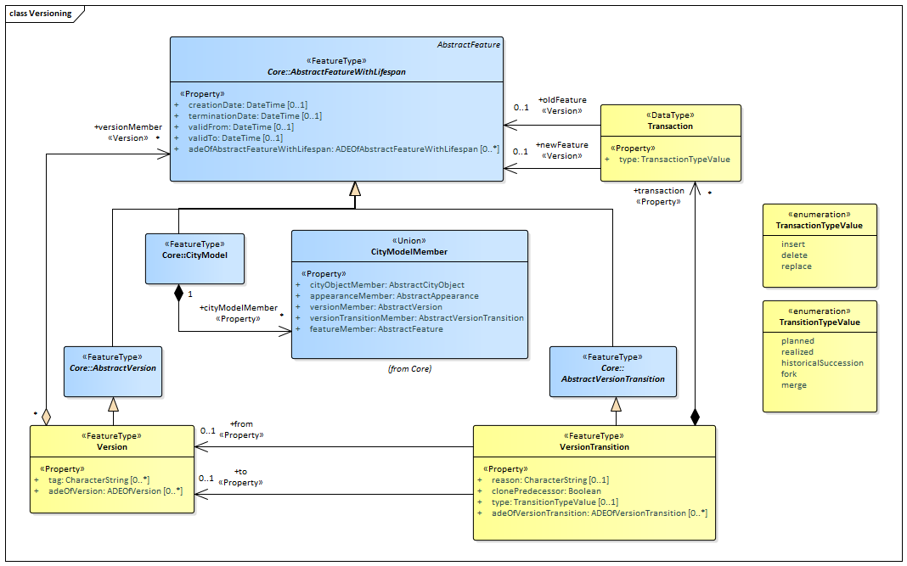
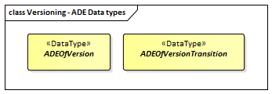

[[ug-model-versioning-section]]
=== Versioning

|===
^|*Contributors*
|C. Heazel - first draft
|T. Kutzner - added further explanations
|===

[[ug-versioning-synopsis-section]]
==== Synopsis

The _Versioning_ module supports the representation of multiple versions of CityGML features within a single CityGML model. In addition, also the version transitions and transactions that lead to the different versions can be represented.

[[ug-versioning-concepts-section]]
==== Key Concepts

[[version-concept]]
<<ug-version-section,*Version*>>: _Version_ represents a defined state of a city model consisting of the dedicated versions of all city object instances that belong to the respective city model version. Versions can have names, a description and can be labeled with an arbitrary number of user defined tags. (See <<ug-version-section,Version>> section for further details.) +
A type of <<abstract-version-concept,AbstractVersion>>.

[[version-transition-concept]]
<<ug-version-transition-section,*VersionTransition*>>: _VersionTransition_ describes the change of the state of a city model from one version to another. Version transitions can have names, a description and can be further qualified by a type and a reason. (See <<ug-version-transition-section,Version Transition>> section for further details.) +
A type of <<abstract-version-transition-concept,AbstractVersionTransition>>.

[[version-transaction-concept]]
<<ug-version-transaction-section,*VersionTransaction*>>: _VersionTransaction_ indicates the specific type of modification applied to a city object in a transition from one city model version to another. (See <<ug-version-transaction-section,Version Transaction>> section for further details.)

[[ug-versioning-discussion-section]]
==== Discussion
The Versioning module defines the concepts that enable representing multiple versions of a city model. A specific version represents a defined state of a city model consisting of the dedicated versions of all city object instances that belong to the respective city model version. Each version can be complemented by version transitions that describe the change of the state of a city model from one version to another and that give the reason for the change and the modifications applied.

By using the Versioning module, slow changes over a long time period with respect to cities and city models can be represented. This includes the creation and termination of objects (e.g., construction or demolition of sites, planting of trees, construction of new roads), structural changes of objects (e.g., extension of buildings), and changes in the status of an object (e.g., change of building owner, change of the traffic direction of a road to a one-way street). In this way, the history or evolution of cities and city models can be modeled, parallel or alternative versions of cities and city models can be managed, and changes of geometries and thematic properties of individual city objects over time can be tracked.

This approach not only facilitates the explicit representation of different city model versions, but also allows distinguishing and referring to different versions of city objects in an interoperable exchange format. All object versions could be stored and exchanged within a single dataset. Software systems could use such a dataset to visualize and work with the different versions simultaneously. The conceptual model also takes into account the management of multiple histories or multiple interpretations of the past of a city, which is required when looking at historical city developments and for archaeological applications. In addition, the Versioning module supports collaborative work. All functionality to represent a tree of workspaces as version control systems like git or SVN is provided. The Versioning module handles versions and version transitions as feature types, which allows the version management to be completely handled using the standard OGC Web Feature Service [<<Vretanos2010>>]. No extension of the OGC Web Feature Service standard is required to manage the versioning of city models.

In order to allow for representing the evolution of real cities and their 3D city models over time, the class <<abstract-feature-with-lifespan-concept,AbstractFeatureWithLifespan>> introduces bitemporal timestamps for all features by defining the following four attributes:

* _creationDate_ and _terminationDate_: These attributes refer to the time period a specific version of a feature is an integral part of the 3D city model. The attributes can be used to query how did the city model look at a specific point in time.
* _validFrom_ and _validTo_: These attributes represent the lifespan a specific version of a feature has in the real-world. The attributes can be used to query how did the actual city look alike at a specific point in time.

The class <<abstract-feature-with-lifespan-concept,AbstractFeatureWithLifespan>> is defined in the <<ug-model-core-section,Core>> module and acts as base class of all CityGML features, i.e., all features that are represented by subclasses of <<abstract-feature-with-lifespan-concept,AbstractFeatureWithLifespan>> inherit the bitemporal timestamps. This includes not only all thematic features defined in the thematic extension modules, such as <<ug-model-building-section,Building>>, <<ug-model-city-furniture-section,CityFurniture>>, or <<ug-model-transportation-section,Transportation>>, but also all features defined in the general extension modules <<ug-model-appearance-section,Appearance>>, <<ug-model-dynamizer-section,Dynamizer>>, <<ug-model-generics-section,Generics>>, <<ug-model-point-cloud-section,PointCloud>>, and <<ug-model-versioning-section,Versioning>>.

The _Versioning_ module extends this concept of bitemporal timestamps by the possibility of representing multiple, concurrent versions of the city model. For that purpose, the module defines two new feature types, _Version_ and _VersionTransition_, which are explained in more detail below.

[[ug-version-section]]
===== Version

The class _Version_ can be used to explicitly define states of the 3D city model and denote all the specific versions of objects belonging to such states. Versions can have the following properties.

* _name_ for providing the version with a specific name. This property is inherited from the class <<abstract-feature-concept,AbstractFeature>> defined in the <<ug-model-core-section,Core>> module.
* _description_ for describing the version in more detail. This property is inherited from the class <<abstract-feature-concept,AbstractFeature>> as well.
* _tag_ for adding user-defined tags to the version. With the help of such tag attributes, the user can, e.g., search for a version developed by a specific worker. The property is of the type _CharacterString_ which means that the user can provide any textual value describing the specific state in the most appropriate way. The property can be provided multiple times.
* _versionMember_ for referencing the objects that that belong to the version. Any object that is a direct or indirect subclass of <<abstract-feature-with-lifespan-concept,AbstractFeatureWithLifespan>> can be part of a version. The objects within each version are referenced via the _featureID_ property that all objects inherit from the class <<abstract-feature-concept,AbstractFeature>> defined in the <<ug-model-core-section,Core>> module.

In this context, a _snapshot_ represents the state of all objects of the entire city model at a specific point in time. It explicitly links to all objects in their versions that belong to the corresponding city model version.

In CityGML, features can have aggregated sub-features. For instance, a building feature may consist of the sub-features roof surface and wall surface, which, in turn, may contain the sub-features window surface or door surface. In case of a change in any of the sub-features, the model would require a change in all the parent features in the aggregation levels above as well, because the aggregate object points to its parts. If a part is replaced by a new version with a new _featureID_, the corresponding pointer of the aggregate object also needs to be updated. This will create a new object version also for the aggregate object, and so on, following the aggregation hierarchy.

[[ug-version-transition-section]]
===== Version Transition

The class _VersionTransition_ allows to explicitly link different versions of the 3D city model, referred to as predecessor and successor versions, by describing the reason of change and the modifications applied. Version transitions represent the causal relationships between the version snapshots.

Version transitions are represented by the following properties.

* _reason_: Specifies why the predecessor version has been changed. This property is optional.
* _clonePredecessor_: Indicates how to obtain the set of objects belonging to the successor version of the city model. The value _false_ indicates that the set of objects is explicitly enumerated within the successor version. The value _true_ indicates that that the set of objects has to be derived from the modifications of the city model that are provided as a list of transactions on the city object versions in the predecessor version. This property is mandatory.
* _type_: Indicates the specific type of the transition, i.e., whether the transition is _planned_, _realized_, a _historicalSuccession_, a _fork_, or a _merge_. Only these five values are allowed; they are defined in the Enumeration _TransitionTypeValue_. _planned_ and _fork_ should be used in cases when from one city model version multiple successor versions are being created. _realized_ and _merge_ should be used when different city model versions are converging into a common successor version. This property is optional.
* _transaction_: Relates to the specific transactions that have been applied to the individual objects in the version transition. A version transition can comprise several transactions.
* _from_: Relates to the predecessor version of the city model that is linked by the version transition to its successor version. This property is optional.
* _to_: Relates to the successor version of the city model that is linked by the version transition to its predecessor version. This property is optional.

Advantages of the version transition approach are that it requires low memory or storage requirements, that it is similar to full back-up or incremental back-up, and that it may also be used to stream dynamic changes.

However, a limitation with this approach is that it may be necessary to determine the actual members of a version by going back via the predecessors. One important aspect is that the merging of two different versions may lead to possible conflicts. For all such convergence situations it must be ensured that the members of the converged version/state can be determined unambiguously. The easiest and safest way is to require that at maximum one of the incoming transitions has transactions. Such transitions are required to be able to detect who has changed an object and whether there are any conflicts. Several methods for detecting changes in CityGML files have already been identified, such as in [<<Redweik2015>>] and [<<Pédrinis2015>>]. These methods may be useful tools to resolve conflicts in a similar way as with the "diff" command in SVN.

[[ug-version-transaction-section]]
===== Version Transaction

This data type provides information on what type of modification has been applied to an individual city object that is part of a specific version. Modifications can be the creation, termination, or replacement of a specific city object. While the creation of a city object also marks its first object version, the termination marks the end of existence of a real world object and, hence, also terminates the final version of a city object. The replacement of a city object means that a specific version of it is replaced by a new version.

Transactions have the following properties.

* _type_: Indicates the specific type of the transaction. Allowed values are _insert_ (creation), _delete_ (termination), or _update_ (replacement); they are defined in the Enumeration _TransactionTypeValue_. This property is mandatory.
* _oldFeature_: Relates to the predecessor version of the city object that is modified by the transaction. This property is optional and it is always empty for the value _insert_.
* _newFeature_: Relates to the successor version of the city object that is modified by the transaction. This property is optional and it is always empty for the value _delete_.

[[ug-versionings-uml-section]]
==== UML Model

The UML diagram of the _Versioning_ module is depicted in <<versioning-uml>>.

[[versioning-uml]]
.UML diagram of the Versioning Model.

The ADE data types provided for the _Versioning_ module are illustrated in <<versioning-uml-ade-types>>.

[[versioning-uml-ade-types]]
.ADE classes of the CityGML Versioning module.

[[ug-versioning-examples-section]]
==== Examples

NOTE:: To Be Provided
