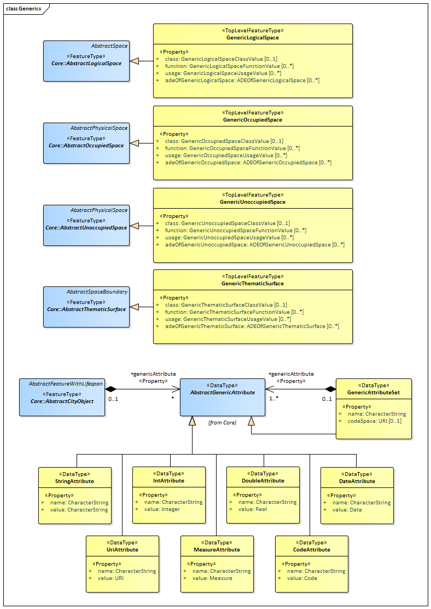
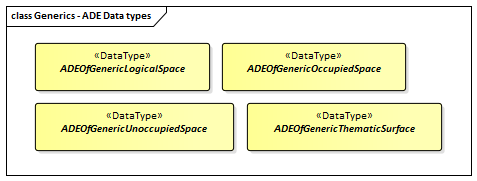
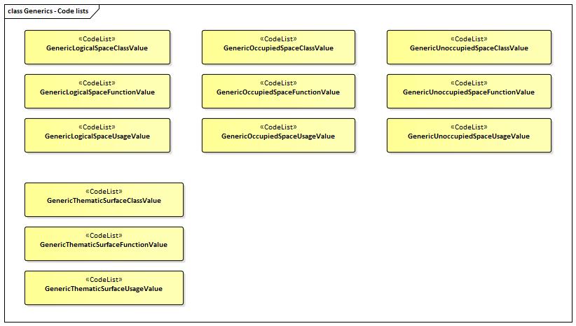

[[ug-model-generics-section]]
=== Generics

|===
^|*Contributors*
|C. Heazel - first draft
|T. Kutzner - update content from v2 to v3
|===

[[ug-generics-synopsis-section]]
==== Synopsis

The _Generics_ module supports application-specific extensions to the CityGML conceptual model. These extensions may be used to model and exchange additional attributes and features not covered by the predefined thematic classes of CityGML. Generic extensions shall only be used if appropriate thematic classes or attributes are not provided by any other CityGML module.

[[ug-generics-concepts-section]]
==== Key Concepts

[[generic-logical-space-concept]]
*GenericLogicalSpace*: A space that is not represented by any explicitly modeled <<abstract-logical-space-concept,AbstractLogicalSpace>> subclass within CityGML. (See <<ug-generic-class-section,Discussion>> for further details.) +
A type of <<abstract-logical-space-concept,AbstractLogicalSpace>>.

[[generic-occupied-space-concept]]
*GenericOccupiedSpace*: A space that is not represented by any explicitly modeled <<abstract-occupied-space-concept,AbstractOccupiedSpace>> subclass within CityGML. (See <<ug-generic-class-section,Discussion>> for further details.) +
A type of <<abstract-occupied-space-concept,AbstractOccupiedSpace>>.

[[generic-unoccupied-space-concept]]
*GenericUnoccupiedSpace*: A space that is not represented by any explicitly modeled <<abstract-unoccupied-space-concept,AbstractUnoccupiedSpace>> subclass within CityGML. (See <<ug-generic-class-section,Discussion>> for further details.) +
A type of <<abstract-unoccupied-space-concept,AbstractUnoccupiedSpace>>.

[[generic-thematic-surface-concept]]
*GenericThematicSurface*: A surface that is not represented by any explicitly modeled <<abstract-thematic-surface-concept,AbstractThematicSurface>> subclass within CityGML. (See <<ug-generic-class-section,Discussion>> for further details.) +
A type of <<abstract-thematic-surface-concept,AbstractThematicSurface>>.

[[generic-attribute-set-concept]]
*GenericAttributeSet*: A named collection of generic attributes. (See <<ug-generic-attribute-set-section,Discussion>> for further details.) +
A type of <<abstract-generic-attribute-concept,AbstractGenericAttribute>>.

[[generic-attribute-concept]]
*StringAttribute*, *IntAttribute*, *DoubleAttribute*, *DateAttribute*, *UriAttribute*, *MeasureAttribute*, *CodeAttribute*: Data types used to define generic attributes of the types _String_, _Int_, _Double_, _Date_, _URI_, _Measure_, or _Code_, respectively. (See <<ug-generic-attribute-section,Discussion>> for further details.) +
A type of <<abstract-generic-attribute-concept,AbstractGenericAttribute>>.

[[ug-generics-discussion-section]]
==== Discussion

The _Generics_ module provides the representation of generic city objects. These are city objects that are not covered by any explicitly modeled thematic class within the CityGML conceptual model. The Generics module also provides the representation of generic attributes, i.e., attributes that are not explicitly represented in the CityGML conceptual model.

In order to avoid problems concerning semantic interoperability, generic city objects and generic attributes shall only be used if appropriate thematic classes and attributes are not provided by any other CityGML module.

In accordance with the CityGML Space concept defined in the  <<ug-model-core-section,Core>> module, generic city objects can be represented as generic logical spaces, generic occupied spaces, generic unoccupied spaces, and generic thematic surfaces. In this way, spaces and surfaces can be defined that are not represented in the CityGML Conceptual Model by any explicitly modeled subclass of the classes <<abstract-logical-space-concept,AbstractLogicalSpace>>, <<abstract-occupied-space-concept,AbstractOccupiedSpace>>, <<abstract-unoccupied-space-concept,AbstractUnoccupiedSpace>> or <<abstract-thematic-surface-concept,AbstractThematicSurface>>.
Generic city objects are represented in the UML model by the top-level feature types <<generic-logical-space-concept,_GenericLogicalSpace_>>, <<generic-occupied-space-concept,_GenericOccupiedSpace_>>, <<generic-unoccupied-space-concept,_GenericUnoccupiedSpace_>> and <<generic-thematic-surface-concept,_GenericThematicSurface_>>.

Generic attributes are defined as name-value pairs and are always associated with a city object. Generic attributes can be of type _String_, _Integer_, _Double_, _Date_, _URI_, _Measure_, and _Code_. In addition, generic attributes can be grouped under a common name as generic attribute sets.
In the <<ug-model-core-section,Core>> module, the class <<abstract-city-object-concept,AbstractCityObject>> is related to the data type _AbstractGenericAttribute_ via the role name _genericAttribute_. This means that each thematic subclass of <<abstract-city-object-concept,AbstractCityObject>> inherits this relation and, thus, the possibility that an arbitrary number of generic attributes can be assigned to each thematic subclass in order to represent additional properties of features not represented by the properties that are explicitly defined in the UML model. This also means that the _Generics_ module has a deliberate impact on all CityGML modules that define thematic subclasses of the class <<abstract-city-object-concept,AbstractCityObject>>.

[[ug-generic-class-section]]
===== GenericLogicalSpace, GenericOccupiedSpace, GenericUnoccupiedSpace, and GenericThematicSurface

These classes are used to define generic city objects by representing them as generic spaces and surfaces in accordance with the CityGML 3 Space concept. All classes represent top level feature types and they are derived from corresponding abstract classes in the <<ug-model-core-section,Core>> module:

* _GenericLogicalSpace_ is to be used for generic city objects that represent _logical_ spaces. The class is derived from the class <<abstract-logical-space-concept,AbstractLogicalSpace>>.
*  _GenericOccupiedSpace_ is to be used for generic city objects that represent _physically occupied_ spaces. The class is derived from the class <<abstract-occupied-space-concept,AbstractOccupiedSpace>>.
*  _GenericUnoccupiedSpace_ is to be used for generic city objects that represent _physically unoccupied_ spaces. This class is derived from <<abstract-unoccupied-space-concept,AbstractUnoccupiedSpace>>.
* _GenericThematicSurface_ is to be used for representing surfaces that bound a space. This class is derived from the class <<abstract-thematic-surface-concept,AbstractThematicSurface>>.

Generic spaces and surfaces provide the properties _class_, _function_ and _usage_ whose values are defined in external code lists:

* The _class_ property indicates the specific type of the space or surface, i.e., it allows for object classification within a thematic area (e.g., water pipes in the field of infrastructure or city zones in the field of city planning). This property is optional and can only be provided once.
* The _function_ property specifies the intended purpose(s) of the space or surface (e.g., water supply or residential zones). This property is optional and can be provided multiple times.
* The _usage_ property specifies the actual usage of the space or surface in cases where the way the object is actually used differs from the intended purpose of the object. This property is optional and can occur multiple times.

The geometry of a generic space or surface can be any of the geometries defined in the <<ug-model-core-section,Core>> module for the classes <<abstract-space-concept,AbstractSpace>>, <<abstract-physical-space-concept,AbstractPhysicalSpace>>, and <<abstract-thematic-surface-concept,AbstractThematicSurface>>. The generic spaces and surfaces inherit the geometries defined for these abstract classes, since they are subclasses thereof. This means:

* All generic spaces can be spatially represented as single point in LOD0, as multi-surface in LOD0/2/3, as solid in LOD1/2/3, and as multi-curve in LOD2/3. Absolute coordinates according to the reference system of the city model must be given for these geometries.
* Generic occupied and unoccupied spaces can, in addition, be complemented with a _TerrainIntersectionCurve_ in LOD1/2/3, in order to specify the exact intersection of the DTM with the 3D geometry of these spaces. This is important for 3D visualization but also for certain applications like driving simulators. For instance, when a city wall (e.g., the Great Wall of China) is to be represented as a _GenericOccupiedSpace_, a smooth transition between the DTM and the city wall needs to be ensured. Above that, both spaces can also be represented by point clouds.
* Generic occupied spaces can, in addition, be spatially represented by an <<implicit-geometry-concept,ImplicitGeometry>>. In this case, a reference point (anchor point) of the object and optionally a transformation matrix must be given. In order to compute the actual location of the object, the transformation of the local coordinates into the reference system of the city model must be processed and the anchor point coordinates must be added. The shape of an <<implicit-geometry-concept,ImplicitGeometry>> can be given as an external resource with a proprietary format, e.g., a VRML or DXF file from a local file system or an external web service. Alternatively the shape can be specified as a 3D geometry with local cartesian coordinates using the property _relativeGeometry_.

[[ug-generic-attribute-section]]
===== StringAttribute, IntAttribute, DoubleAttribute, DateAttribute, UriAttribute, MeasureAttribute, and CodeAttribute

These data types are used to define generic attributes of the types _String_, _Integer_, _Double_, _Date_, _URI_, _Measure_, or _Code_, respectively. The data types are derived from the abstract data type _AbstractGenericAttribute_ that is defined in the <<ug-model-core-section,Core>> module.

Each generic attribute has two mandatory properties:

. _name_ for specifying the name of the generic attribute. The name can be freely chosen.
. _value_ for specifying the value of the generic attribute. The type of the value may be _String_, _Integer_, _Double_ (floating point number), _Date_, _URI_, _Measure_, or _Code_, depending on the selected subclass.

A _MeasureAttribute_ facilitates the representation of measured values. Its value is of the structured type _Measure_ which can additionally provide the units of measure via an optional attribute _uom_ (units of measure).

[[ug-generic-attribute-set-section]]
===== GenericAttributeSet

Generic attributes can be grouped under a common name using a _GenericAttributeSet_. _GenericAttributeSet_ is a data type that is derived from the data type _AbstractGenericAttribute_ defined in the <<ug-model-core-section,Core>> module; thus, generic attribute sets represent generic attributes themselves. This means that generic attribute sets may also be contained in other generic attribute sets, facilitating a recursive nesting of arbitrary depth.

The value of a generic attribute set is implicitly the set of contained generic attributes to which _GenericAttributeSet_ relates via the role name _genericAttribute_.
The _name_ property specifies the name for the entire generic attribute set.
The optional _codeSpace_ property (of type _URI_) can be used to associate the generic attribute set with an authority, e.g., the organisation or community that defines and maintains the generic attribute set and its contained attributes. In this way, generic attribute sets can be clearly distinguished from each other even if they share the same name.

[[ug-generics-uml-section]]
==== UML Model

The UML diagram of the _Generics_ module is depicted in <<generics-uml>>.

[[generics-uml]]
.UML diagram of the Generics Model.

The ADE data types provided for the _Generics_ module are illustrated in <<generics-uml-ade-types>>.

[[generics-uml-ade-types]]
.ADE classes of the CityGML Generics module.

The Code Lists provided for the _Generics_ module are illustrated in <<generics-uml-codelists>>.

[[generics-uml-codelists]]
.Codelists from the CityGML Generics module.

[[ug-generics-examples-section]]
==== Examples

*Under Construction*
